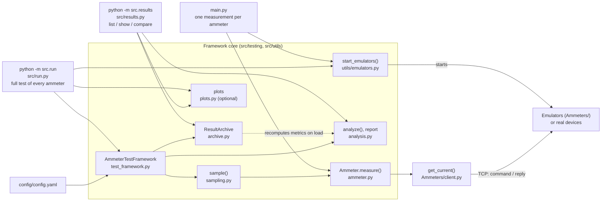

# Design Decisions

How the framework is built and why. For usage see [README.md](README.md); for the defects fixed in the provided
code see [FIXES.md](FIXES.md).

## Architecture

Solid arrows mean "calls"; the dotted arrow is the recomputation of metrics when a run is loaded from the archive.
`main.py` and the command line also read `config.yaml` (through `load_config`); that is left out to keep the diagram
readable. The entry points on the left are drawn outside the core: `main.py` is provided code, `src/run.py` and
`src/results.py` are the framework's command-line programs. `Ammeters/` is the provided emulator and client code.
`examples/run_tests.py` is not shown: it is kept unchanged as provided and calls nothing (see FIXES.md).

Each layer knows only the one below it:

| Layer | Knows about | Does not know about |
|---|---|---|
| `client.py` | sockets, bytes, the reply format | which ammeter it talks to |
| `ammeter.py` (unified API) | one ammeter's address and command | sampling, statistics, files |
| `sampling.py` | timing and the series | how a measurement is taken |
| `analysis.py` | numbers of a series | where they came from |
| `archive.py` | files and metadata | how the numbers were measured |

So a different transport (e.g. a serial port instead of TCP) would only replace the client, and the rest would
stay as it is.

## Decisions

### Data

- **Results are immutable dataclasses** (`Measurement`, `Sample`, `SampleSeries`, `SamplingConfig`, `ValueStats`,
  `TestResult`, `RunRecord`). A measurement is a fact and must not change on its way through analysis and the
  archive; `frozen=True` turns an accidental change into an immediate error. Dataclasses also generate `==`, which
  makes saving and loading testable with one comparison. Collections are tuples, because frozen protects fields
  but not the contents of a list. Alternatives: plain dicts (no checking, typos found only at run time),
  `namedtuple` (behaves like a tuple), pydantic (external dependency).
- **Derived values are properties, not stored fields** (`Measurement.ok`, `Sample.lag_s`, `SampleSeries.timing`),
  so they cannot contradict the data they come from.
- **Validation lives in factory functions** (`SamplingConfig.from_config()`, `load_ammeters()`), not in the
  constructors. The factories know the context for clear messages ("Ammeter 'entes': 'port' must be an
  integer..."), and tests can still build objects with any values to check edge cases.

### Unified measurement API

- **`Ammeter.measure()` never raises for a failing ammeter.** A refused connection, a timeout or an invalid reply
  becomes a `Measurement` with `value=None` and the reason in `error`. For a test station a failure of the device
  is a result, not a crash: one failure must not stop a series, and the failure rate belongs in the report. Only
  `AmmeterError` is caught, so a bug in the framework itself still raises and is not disguised as a device failure.
  The lower-level `get_current()` does raise typed errors (`AmmeterConnectionError`, `AmmeterResponseError`),
  which is right for a single request.
- **The client validates every reply**: it reads until the server closes the connection (a reply may arrive in
  several TCP parts), and rejects empty replies, `ERROR` replies, non-numbers and `nan`/`inf`, which `float()`
  would accept and which would silently corrupt the statistics.

### Configuration

- **Everything is in `config.yaml` and is validated before anything runs**, with a `ConfigError` that names the
  setting. Special cases are checked explicitly: `port: true` (in Python `bool` is a subclass of `int`), `.inf`
  durations, two ammeters on one port, an emulator configured for a remote host.
- **Emulators are configured by import path** (`emulator: Ammeters.Greenlee_Ammeter.GreenleeAmmeter`), loaded with
  `importlib` and checked to be a concrete `AmmeterEmulatorBase` subclass. A new emulator needs only its class file
  and a config entry; an ammeter without `emulator` is a real device and is only queried. Alternatives: a registry
  dict in code (needs a code change per emulator), automatic registration of subclasses (implicit, harder to debug).
  All classes are loaded before any emulator starts, so a typo never leaves a half-started setup.

### Error simulation

- **Faults are simulated by the emulators, configured per ammeter** (`simulate_errors`): an `ERROR` reply, a reply
  that is not a number, no reply, or a slow reply. With live emulators misbehaving, an ordinary run shows how the
  framework counts failures, groups their reasons and shifts the schedule. Only emulators can be told to fail;
  `simulate_errors` without `emulator` is a config error.
- **One random number per request falls into one probability range**, in a fixed order, so the probabilities do not
  overlap and the rest are normal replies; they must add up to at most 1.
- **A separate random generator with an optional seed.** The provided emulators reseed the module-level `random` with
  the current time for their values; the faults use their own `random.Random(seed)`, so a seed makes the faults
  repeatable (needed by tests) without fixing the measured values.
- **The settings are archived with the run** and shown by `show`, so a run with simulated faults is never mistaken
  for a failing device.
- **Unknown keys are errors**: a typo such as `garbge: 0.1` would otherwise silently mean "no faults".

### Starting emulators

- **Wait for a ready signal, not a fixed sleep.** The original `main.py` slept 5 s and hoped the servers were up.
  `start_server()` now sets a `threading.Event` right after `listen()`, and a startup failure is reported through
  the same event. `main.py` went from about 5 s to under 0.1 s, and a fixed sleep (the main source of flaky tests)
  is gone. Probing the port instead was rejected: a foreign process on the port would look like a ready emulator.

### Sampling

- **Any two of count, duration and frequency define the third** (`count = duration x frequency`). Contradicting
  values, fewer than two values, or a duration and frequency that do not give a whole number of measurements are
  errors rather than a silent choice or rounding. Measurement `i` starts at `i / frequency`, so 20 measurements at
  10 Hz start at 0.0 ... 1.9 s; the duration covers 20 intervals, not "first to last start".
- **The schedule uses fixed moments, not `sleep(interval)`.** Sleeping a fixed interval after each measurement adds
  the measurement time and every wake-up delay to the next start. In a check with 100 measurements at 50 Hz this
  loop ended 377 ms late (42 Hz instead of 50); waiting until moment `i / frequency` ended 3.5 ms late. Moments are
  computed from the index, not by adding the interval repeatedly, so float rounding does not add up either.
- **A measurement that cannot start on time shifts the rest of the schedule.** If a slow reply makes the next moments
  pass, the next measurement starts at once, is marked `late`, and the remaining schedule moves by the delay. No
  measurement is skipped (the count is kept) and a slow ammeter does not get a burst of catch-up requests. The
  first version caught up instead; a test with a slow fake ammeter showed six catch-up requests sent practically
  at once (all at 1.02 s), which is why it was changed.
- **Plain `time.sleep()`**, without a more precise waiting scheme. A hybrid of long and short sleeps was measured
  to cut the lag from about 3 ms to 0.1 ms on macOS, but it adds logic, and the lag does not add up anyway. The
  timing report shows the lag of every run (see README, platform notes).
- **The timing report shows more than the average frequency**: lag, late count, schedule shift, and the shortest
  and longest interval between measurements. A run with a 350 ms stall had an average frequency of "almost exactly
  10 Hz"; the interval range shows such local problems at once.
- **The clock and the sleep function are parameters of `sample()`** (dependency injection), so tests replace them
  with a fake clock and check the schedule exactly and instantly.

### Analysis

- **Standard library `statistics` only.** Sample standard deviation (`n - 1`), because a series is a sample of
  what an ammeter can return. Undefined metrics are `None` (no values, one value for the deviation, a mean of 0 for
  the relative spread) instead of an error.
- **`relative_spread = stdev / |mean|`** because the ammeters have very different scales (around 0.1 and around
  50): their absolute deviations cannot be compared, their relative spreads can.
- **Response time is analysed like the values, over all requests including failed ones**: a device that answers in
  1 ms and sometimes in 300 ms is not consistent, even if its values are fine.
- **The report setting only selects what is printed**; all metrics are always computed and archived, so archived
  runs stay comparable whatever the report showed.

### Result archive

- **One JSON file per run.** Standard library, readable without tools, diff-friendly, and one damaged file does not
  affect the others. SQLite was considered and rejected as unnecessary for this volume.
- **Run ID `YYYYMMDD-HHMMSS-<ammeter>-<8 hex>`**, time in UTC: sorts by time on any machine, shows what was tested,
  and the random part makes collisions practically impossible (about one in 4 billion per second and ammeter).
  An existing ID is never overwritten.
- **Atomic save**: write a temporary file in the same folder, `fsync`, then `os.replace` (atomic, and unlike
  `os.rename` it also replaces on Windows). A crash leaves either the complete file or none.
- **Metadata for reproducibility**: ammeter and sampling settings, Python version, OS and the git commit, marked
  `+dirty` when Python files have uncommitted changes (only `*.py`, so saved output files do not count).
- **Loading rebuilds the same objects as a fresh run and recomputes the metrics** from the raw measurements, so
  reports and comparisons share one code path, and an edited summary in a file cannot show wrong numbers. The
  tests check `loaded == saved` for normal, failed and late runs.
- **`format_version`** in every file, so the format can change later and old files are still recognised.

### Plots

- **matplotlib is optional** (`requirements-plot.txt`): with the 13 packages it brings (numpy among them) it is 21 MB,
  against 172 KB for PyYAML, and most uses (test benches, CI, overnight runs) need no plots. It is imported only
  inside the plotting functions; without it `plot` names the file to install and `python -m src.run` skips plots.
- **The Agg backend** writes files without a display, so plots work in CI and on headless machines.
- **One axis per chart.** Values, response times and start delays have different units, so each is its own panel
  rather than sharing a chart with two scales.
- **One series, one color**; red and orange appear only where they mean "failed" and "late", always with a legend
  label. A failed measurement has no value, so it is marked on the bottom edge, apart from the data.
- **Comparisons use values relative to each run's mean**, for the same reason as `relative_spread`: the ammeters'
  scales differ by a factor of hundreds. All boxes share one color, because the runs are named on the axis.
- **Light and dark versions** use separately chosen colors (not an inversion), checked for contrast against their
  background; the README shows the one that matches the reader's GitHub theme.

### Dependencies

- **Runtime: PyYAML only; plots optional with matplotlib.** The original `requirements.txt` listed numpy, scipy, matplotlib, seaborn and pandas,
  none of which the code imports; they were removed, as the spec asks to minimise dependencies.
- **Development: pytest and pytest-cov** in a separate `requirements-dev.txt`, which also includes the plot
  requirements so the plots are tested.

## Error handling

| Situation | Where it is handled | What the user sees |
|---|---|---|
| Invalid or missing config value | `load_config`, `load_ammeters`, `SamplingConfig`, `archive_settings_from_config` | `ConfigError` naming the setting; scripts exit with code 1 |
| Emulator port busy, emulator not ready in time | `start_emulators` | `EmulatorStartError` listing every emulator that failed; the others keep running |
| Ammeter unreachable, timeout, reset | `get_current` → `measure` | failed measurement with the reason; the series continues |
| `ERROR` reply, empty reply, not a number, `nan`/`inf` | `get_current` → `measure` | failed measurement with the reason |
| Unknown command sent to an emulator | `base_ammeter.py` | `ERROR: unknown command ...` reply instead of a silent close |
| Client aborts the connection | `base_ammeter.py` | warning in the log; the emulator keeps serving |
| Crash while saving a run | `ResultArchive.save` | `ArchiveError`; no broken file is left |
| Broken, foreign or newer run file | `ResultArchive` | skipped by `list` with a warning; `show` gives a clear error |
| Unknown or ambiguous run ID | `ResultArchive.load` | error listing the matches; exit code 1 |

## Limitations

- **Ammeters are tested one after another**, not at the same time. Comparing ammeters measured in parallel would
  need concurrent series.
- **An emulator serves one client at a time** and reads a command with a single `recv(1024)` (provided code, kept).
- **Timing precision is limited by the operating system's sleep**; see the measured lag in README.
- **On Windows a refused connection takes about 2 s**, so an unreachable ammeter makes its series fall behind.
- **Emulator threads cannot be stopped** (provided code runs forever); they are daemon threads and end with the
  program.

## Extending

- **New ammeter or emulator**: a config entry, plus a subclass of `AmmeterEmulatorBase` for an emulator.
- **New metric**: compute it in `ValueStats.from_values()`, add the field to `ValueStats` and its name to `METRICS`;
  the report, its config selection and the archive follow from these. `compare` lists its rows explicitly
  (`_COMPARE_ROWS` in `src/results.py`), so the metric needs a row there too.
- **Other transport**: replace `get_current()`; `Ammeter.measure()` and everything above it stay as they are.
